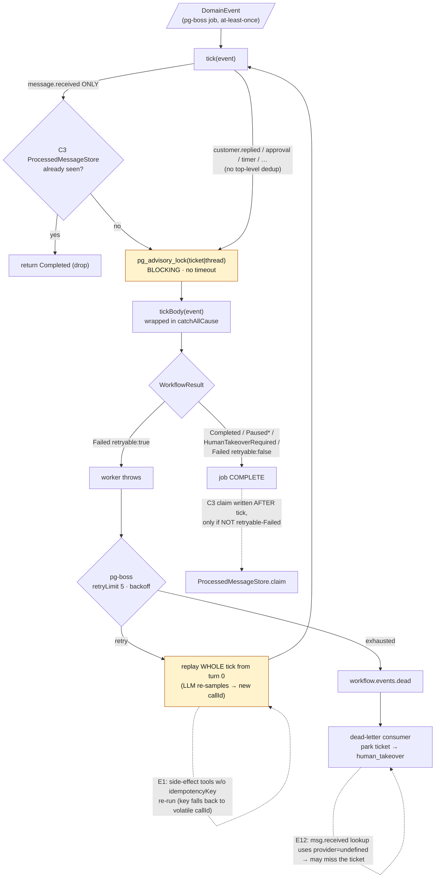
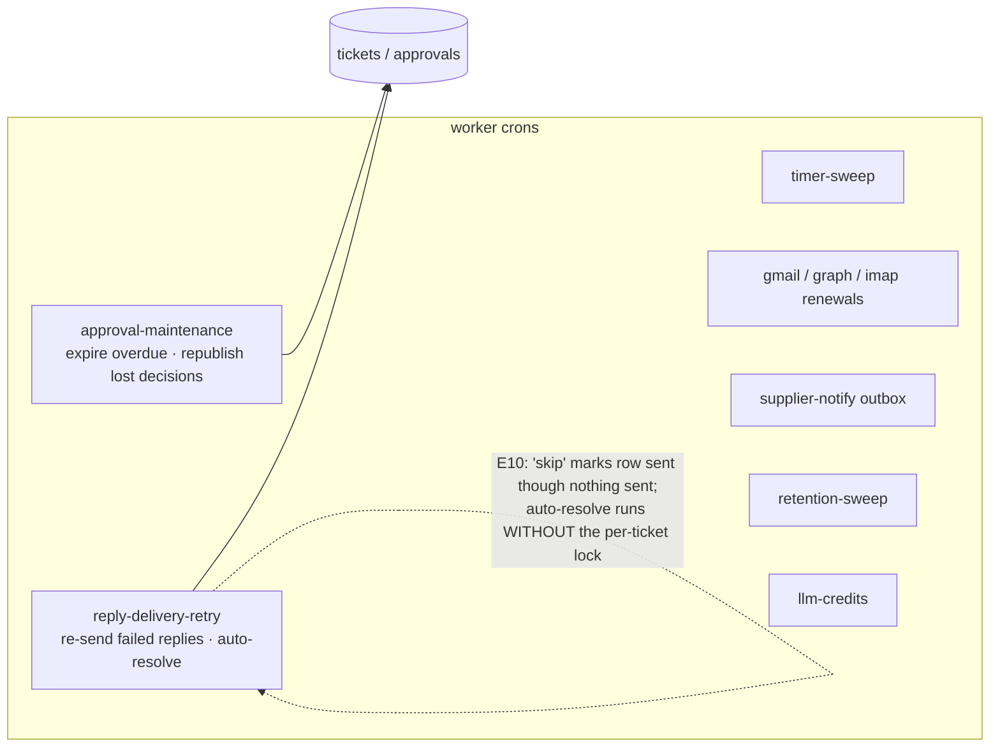
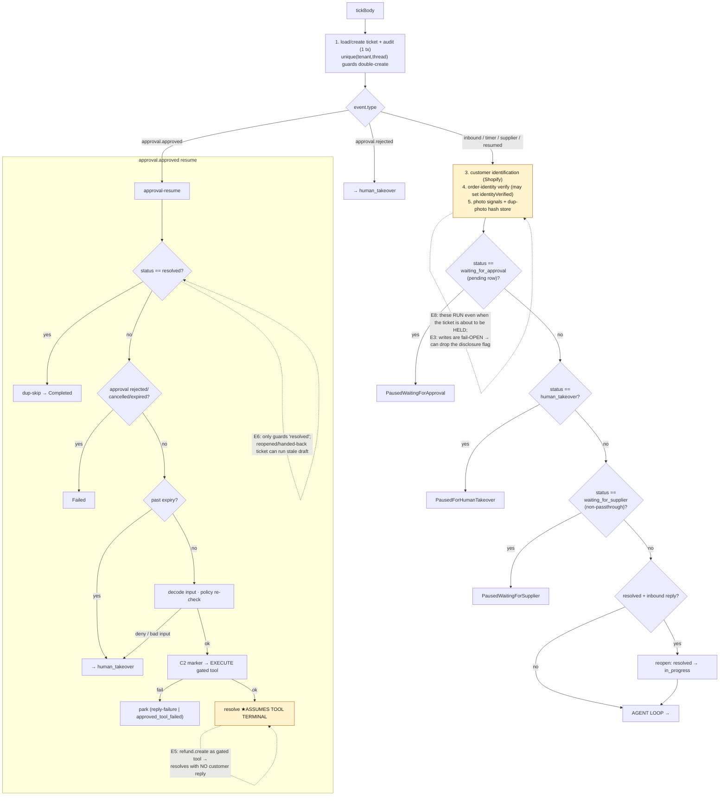
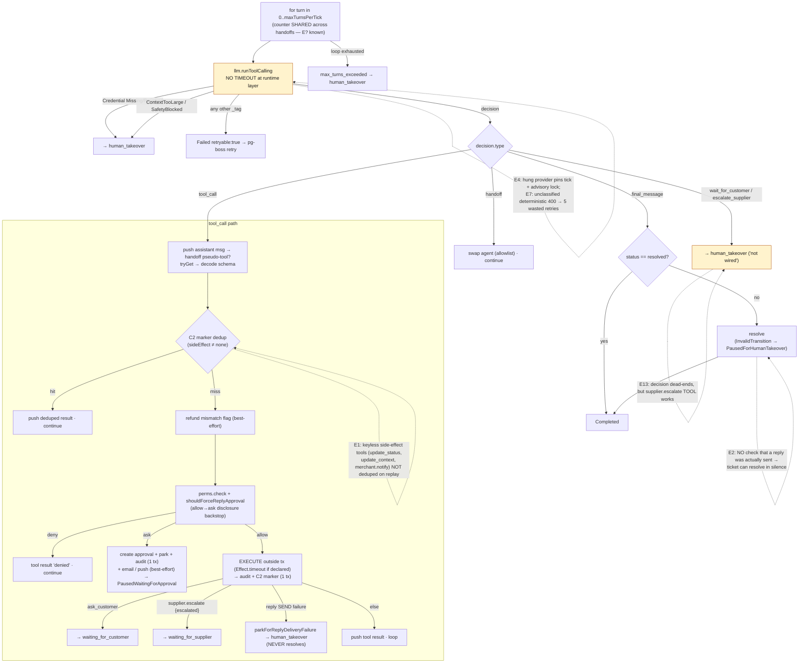
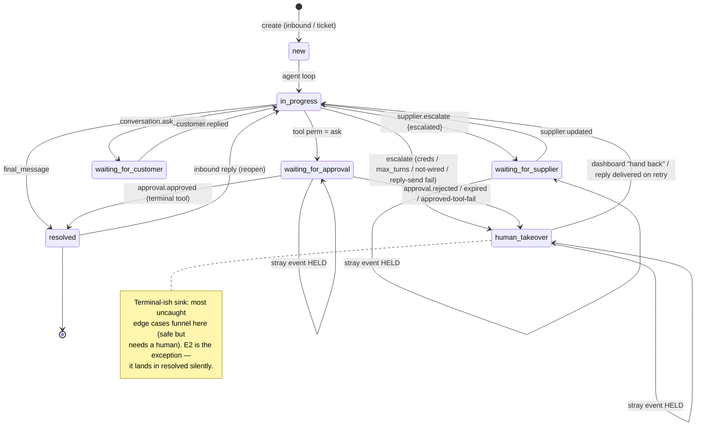

# Agent runtime — flow, retries & uncaught edge cases

Investigation of `packages/services/src/agent-runtime.ts` (the `tick`/`tickBody` spine)
plus its worker dispatch (`apps/worker/src/index.ts`), retry model
(`workflow-job.ts`, `workflow-queue-live.ts`, `workflow-dead-letter.ts`) and the
out-of-band recovery crons.

Edge cases are labelled **E1–E13** and colour-coded by severity. ✅ = confirmed in
code · 🔎 = needs a quick verify. See [§ Edge-case catalogue](#edge-case-catalogue)
for the write-ups.

> **Rendering note.** If your viewer threw `UnknownDiagramError: No diagram type
> detected …`, it fed this file's prose into Mermaid instead of parsing only the
> fenced ` ```mermaid ` blocks. Use a viewer that understands Markdown (GitHub,
> VS Code Markdown Preview Mermaid Support, Obsidian), **or** render the
> prose-free standalone diagrams in [`docs/diagrams/`](./diagrams/) — paste any
> `.mmd` file into <https://mermaid.live>:
>
> - `01-dispatch-retry.mmd` — top-level dispatch + retry/redelivery
> - `02-tickbody-preloop.mmd` — load, approval-resume, park guards
> - `03-agent-loop.mmd` — the per-turn agent loop
> - `04-state-machine.mmd` — ticket state machine

---

## 1. Top-level dispatch + retry / redelivery model



**Out-of-band recovery crons** (each its own pg-boss queue, all best-effort):



---

## 2. tickBody — pre-loop (load, approval-resume, park guards)



---

## 3. tickBody — the agent loop



---

## 4. Ticket state machine (as driven by the runtime)



---

## Edge-case catalogue

Severity: 🔴 high · 🟠 medium · 🟡 lower.

| ID | Sev | What's not caught | Confirmed |
|----|-----|-------------------|-----------|
| **E1** | 🔴 | Side-effecting tools **without an `idempotencyKey`** (`ticket.update_status`, `ticket.update_context`, `merchant.notify`) re-execute on pg-boss retry — the C2 key falls back to `decision.callId`, which the LLM regenerates on every re-sample. | ✅ |
| **E2** | 🔴 | A ticket can `resolve` via `final_message` with **no customer reply ever sent** — the runtime never asserts an outbound message happened. Reply-delivery park only fires on a *send error*, not on the agent skipping the reply. | ✅ |
| **E3** | 🔴 | The `order_customer_mismatch` / `refund_customer_mismatch` flags are written **fail-open** (`catchAll → current`). `shouldForceReplyApproval` reads in-memory `current.context`; a DB blip on that write drops the flag → the cross-customer disclosure gate doesn't fire → auto-reply leaks another customer's order. | ✅ |
| **E4** | 🟠 | **No timeout on `llm.runToolCalling`** at the runtime layer (tools honour `tool.timeout`; the LLM call doesn't). A hung provider pins the tick *while holding the `pg_advisory_lock`* → every other event for that ticket blocks; job can expire/redeliver underneath. | ✅ |
| **E5** | 🟠 | Approval-resume **assumes the gated tool is terminal** and always `resolve`s after it. If `refund.create` is the gated action (conditional-threshold), approving issues the refund and resolves with no customer reply. | ✅ |
| **E6** | 🟠 | Approval-resume's redelivery dup guard only checks `status == resolved`. A ticket that went `waiting_for_approval → expired → human_takeover → handed back → in_progress` can still run a stale `approved` draft. | 🔎 |
| **E7** | 🟠 | Only `ContextTooLarge` / `SafetyBlocked` / `Credential*` short-circuit; any other LLM `_tag` is treated as transient. A deterministic 400 (e.g. tenant model-override → non-existent model id) burns all 5 retries before dead-lettering, every message. | ✅ |
| **E8** | 🟠 | Park guards run **after** customer-identification / identity-verify / photo-hash steps, so a reply to a *held* ticket still mutates context and records image hashes. "Held" events aren't inert. | ✅ |
| **E9** | 🟡 | Top-level `ProcessedMessageStore` dedup covers **`message.received` only** — `customer.replied`, `timer.expired`, etc. rely solely on C2 + the lock (compounds E1). | ✅ |
| **E10** | 🟡 | Reply-delivery cron marks a row **`sent` on "skip"** though nothing was sent (draft silently dropped, data reads "sent"); its auto-resolve runs **without the per-ticket advisory lock**. | ✅ |
| **E11** | 🟡 | `ToolExecutionStore` / `ProcessedMessageStore` are optional — if a deploy forgets to wire them, **all dedup silently degrades** (same failure class as the connector-cron prod outage). No boot-time assertion. | ✅ |
| **E12** | 🟡 | Dead-letter consumer looks up `message.received` tickets with `provider=undefined` (tickBody uses the parsed provider). If `findByThreadId` filters on provider, a dead-lettered inbound may not find its ticket → dangles un-parked. | 🔎 |
| **E13** | 🟡 | The `escalate_supplier` / `wait_for_customer` *decision types* still dead-end to human ("not wired"), but supplier escalation is wired via the `supplier.escalate` *tool* — a model emitting the decision gets parked instead. | ✅ |

### Where to start
**E1**, **E2**, **E3** have real customer/security impact and small, testable fixes:
- **E1** — give the three tools idempotency keys, or scope the C2 marker to `deliveryScopeFor(event)` instead of the volatile `callId` for keyless tools.
- **E2** — track "did an outbound reply fire this tick?" and flag/withhold resolve when `final_message` lands with none.
- **E3** — make the disclosure-guard write **fail-closed**: if the flag can't persist, force the reply to approval (or fail the tick retryable) rather than letting it auto-send.
